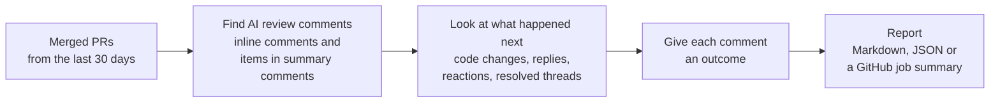
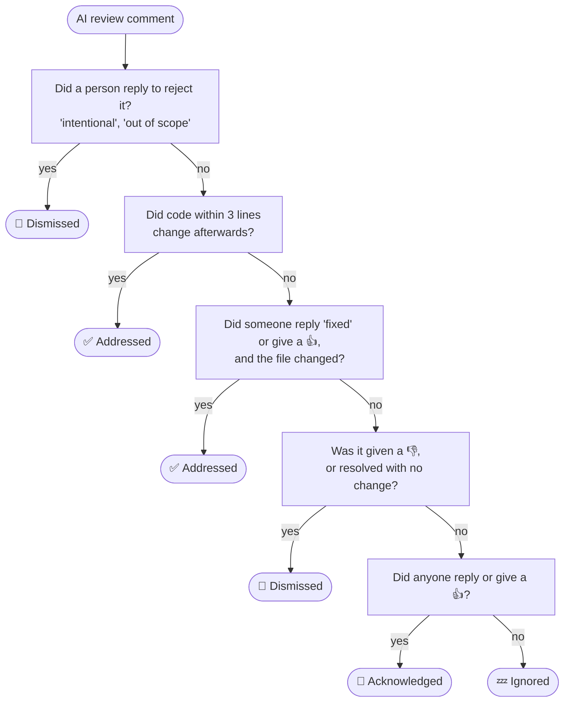

<h1 align="center"></h1>

<p align="center"><b>Does your team act on what its AI code reviewers say?</b></p>

AI reviewers like Claude, Greptile, Copilot and CodeRabbit now comment on most pull requests. `mindthebot` tells you how many of those comments led to a fix, how many were pushed back on, and how many nobody looked at.

```bash
npx mindthebot --repo owner/name
```

It only reads from GitHub. It never comments on, changes or approves a PR.

## What you get

A report with one line per reviewer:

| Reviewer | Addressed | Findings |
|:--|:--|--:|
| 🟢 **Copilot**<br><sub>Mostly acted on</sub> | `████████░░` **79%** | 152 |
| 🟢 **Greptile**<br><sub>Mostly acted on</sub> | `██████░░░░` **64%** | 173 |
| 🟡 **CodeRabbit**<br><sub>Partly acted on</sub> | `██████░░░░` **57%** | 206 |
| 🟡 **Claude**<br><sub>Partly acted on</sub> | `█████░░░░░` **54%** | 112 |

<sub>Merged PRs from eight public repos (VS Code, supabase, TanStack Query, cline, cal.com, PostHog, openai/codex, claude-code-action), last 30 days, run on 16 Nov 2026. 🟢 60%+ addressed · 🟡 40–59% · 🔴 under 40%.</sub>

Below that, the report lists:

- the files with the most ignored comments, linked to the exact lines
- addressed, dismissed, acknowledged and ignored counts per reviewer and per repo
- results by the severity each reviewer gave (for example Greptile's P1 vs P2)
- time to merge for PRs with and without AI comments

The numbers show how a team responds to its reviewer, not which reviewer is best.

## How it works



Each AI comment is one **finding**. For every finding, mindthebot asks a few questions in order and stops at the first "yes":



| Outcome | Means |
|---|---|
| ✅ **Addressed** | The code was changed in response. |
| 🚫 **Dismissed** | Someone decided not to act on it. |
| 💬 **Acknowledged** | Someone responded, but nothing changed yet. |
| 💤 **Ignored** | No reply, no reaction, no change. |

Items in a summary comment (such as Claude's "Code Review: 2 issues found") can't be replied to, so they are either **addressed** or **not addressed**.

Every finding in the JSON output records which rule decided it, so you can check any number. The rules are heuristics: a nearby change isn't proof it fixed the comment, and a fix made in a later PR looks ignored. [docs/heuristics.md](docs/heuristics.md) has the full rules and their limits.

## Run it locally

You need Node 22+ and a GitHub token: `GITHUB_TOKEN`, or your GitHub CLI login (`gh auth login`). Read-only access is enough.

```bash
npx mindthebot --repo owner/name                         # last 30 days, Markdown
npx mindthebot --repo owner/a,owner/b --since 2w         # several repos
npx mindthebot --repo owner/name --format json -o report.json
```

| Option | Default | |
|---|---|---|
| `--repo` | required | `owner/name`; repeat or comma-separate for several |
| `--since` | `30d` | how far back to look: `12h`, `30d`, `2w` |
| `--max-prs` | `200` | most merged PRs to read per repo |
| `--format` | `md` | `md` or `json` |
| `--out` | stdout | write the report to a file |
| `--config` | built-in | YAML file to change reviewers, distance or phrases ([example](mindthebot.example.yml)) |
| `--no-cache` | cache on | GitHub responses are cached in `.mindthebot/cache/` |

**Reviewers it knows:** Claude, Greptile, Copilot, CodeRabbit, Cursor Bugbot, Cubic, Codex and Gemini. Add any other bot in the config.

## Run it every week (GitHub Action)

Add this workflow and the report appears on each run's summary page:

```yaml
# .github/workflows/mindthebot.yml
name: Mind the bot
on:
  schedule:
    - cron: "0 8 * * 1"   # Mondays at 08:00 UTC
  workflow_dispatch:

permissions:
  contents: read
  pull-requests: read

jobs:
  mindthebot:
    runs-on: ubuntu-latest
    steps:
      - uses: thomaschaplin/mindthebot@v1
        with:
          since: 7d
```

| Input | Default | |
|---|---|---|
| `repos` | this repo | `owner/name`, comma- or newline-separated |
| `since` | `7d` | how far back to look |
| `max-prs` | `200` | per repo |
| `config` | built-in | path to a YAML config |
| `output` | `job-summary` | `job-summary` or `none` |
| `github-token` | `${{ github.token }}` | use a PAT or GitHub App token to read other private repos |

It also writes `mindthebot.md` and `mindthebot.json`, and sets the outputs `findings` and `by-bot` (rates per reviewer as JSON), so a later step can upload the report or alert on a rate.

This repo runs it on itself every week: [.github/workflows/mindthebot.yml](.github/workflows/mindthebot.yml).

## Development

```bash
npm install
npm test                           # unit and fixture tests
npm run typecheck
npm run dev -- --repo owner/name   # run from source
npm run build                      # build the CLI and the Action bundle
npm run check-dist                 # fail if the committed Action bundle is out of date (CI runs this)
```

## Roadmap

- [ ] Hand-label 30 findings and publish how often the rules agree
- [ ] Group findings by category (bug, security, style)
- [ ] Plant known bugs to measure what reviewers *miss*, not just what they say

## Licence

MIT
